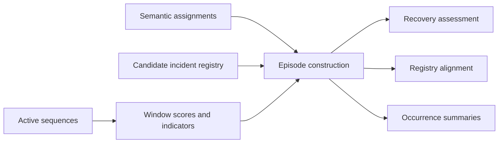

# Model_D

`Model_D` introduces the longitudinal incident layer on top of sequence and
semantic outputs. It combines explicit scoring, segmentation, family
assignment, recovery assessment, registry evaluation, and occurrence-oriented
summaries.

## Architectural view



## Main responsibilities

- `detection.py`: window-level deviation scoring with typed weighting
- `segmentation.py`: sustained onset detection and temporal gap handling
- `classification.py`: explainable rule-based family assignment
- `recovery.py`: hysteresis-inspired recovery confirmation
- `evaluation.py`: temporal validation against a canonical incident registry
- `episodes.py`: orchestration layer that materializes detected episodes
- `occurrence.py`: family-level recurrence summaries
- `registry_builder.py`: weakly labelled candidate-registry generation

## Inputs

The current baseline is compatible with:

- sequence tables with `start_time` and `end_time`
- semantic assignments with at least `semantic_status` and `incident_family`
- candidate or canonical registries with documented incident intervals

When advanced deviation indicators are available, `Model_D` also consumes
window-level metrics such as `sequence_divergence`, `duration_drift`,
`recurrence_excess`, `persistence_excess`, `consumption_deviation`,
`state_error_rate`, and `mode_divergence`.

## CLI examples

Default execution:

```bash
python -m iabm_incidents.main   --sequences path/to/active_sequences.csv   --assignments path/to/semantic_assignments.csv   --output-dir outputs/model_d   --output-format csv
```

Execution with explicit configuration and registry alignment:

```bash
python -m iabm_incidents.main   --config configs/model_d.example.json   --sequences path/to/active_sequences.csv   --assignments path/to/semantic_assignments.csv   --registry path/to/candidate_incident_registry_refined.csv   --output-dir outputs/model_d   --output-format csv
```

## Batch support

The repository-level utility `src/generate_candidate_incident_registry_batch.py`
creates month-wise weakly labelled registries that complement the semantic
outputs produced upstream by `generate_model_bc_batch.py`.

## Full-Horizon Reassessment

The repository now includes a consolidated `Model_D` reassessment across the
full requested horizon from **2022-01** through **2026-06**. The resulting
artifacts are written to:

- `src/predictions/Model_D/final_reassessment/model_d_final_report.html`
- `src/predictions/Model_D/final_reassessment/model_d_final_mode_summary.csv`
- `src/predictions/Model_D/final_reassessment/model_d_final_month_summary.csv`
- `src/predictions/Model_D/final_reassessment/model_d_reassessment_metadata.json`
- `src/predictions/Model_D/final_reassessment/model_d_reassessment_salvedades.json`

### Current interpretation baseline

- The latest full-horizon run processed `50` available months.
- Missing months inside the requested horizon are explicitly tracked as
  `202211`, `202212`, `202408`, and `202506`.
- `202505` is currently flagged as a low-data month and should not be read as a
  strong nominality signal.
- Across the latest consolidated run, the semantic route remained the most
  efficient and informative baseline, while the indicator route remained useful
  as a complementary confirmation path.

### Executive reading guidance

When interpreting the final report, prioritize:

- `episode_recall`
- `family_recall`
- `mean_temporal_iou`
- runtime and month coverage

Treat `episode_precision` and `family_precision` as provisional engineering
metrics until the registry-matching evaluator is tightened to avoid repeated
alignment inflation.

## Outputs

- `window_scores`
- `detected_episodes`
- `family_assignments`
- `recovery_assessment`
- `evaluation_summary`
- `occurrence_summary`
- `incident_registry_matches` and `registry_evaluation_summary` when a registry is provided
- `model_d_run_metadata.json`

### Command-response and transient-concentration extension

The Model D vector now accepts nine components, in the original order:

`[sequence_divergence, duration_drift, recurrence_excess, persistence_excess,
consumption_deviation, state_error_rate, mode_divergence,
command_response_deviation, transient_concentration]`.

`command_response_deviation` is the **mean Euclidean norm** of signed,
state-standardized three-phase residuals over admissible samples. Phase means
(`command_response_signed_RP1`, etc.) preserve under-response/over-response;
`command_response_imbalance` is the mean across-phase standard deviation.
These are evidence descriptors, not independently confirmed failure families.
They supplement the existing state-conditioned consumption deviation.

Following the QIP branch of the attached CReST atlas, causal coordinates are
RP1–RP3 at the current and previous sample plus common mode at lags two and
three. Reference centering and regularized covariance whitening give `z`.
The operator and the scientific indicator are

```text
F(z) = mean[(||z||² / 8) z zᵀ]
D_w = (F_w - F_0) / s_0,   s_0 = max(trace(F_0) / 8, 1e-8)
Tconc = max(lambda_max(D_w), 0) ** (1/4)
```

The exact eigensolver defines `transient_concentration`. Optional
`VQEDirectionSolver` maximizes the Rayleigh quotient of **the identical D** using
three simulated qubits, RY/CX layers and Rotosolve. It exports
`transient_concentration_vqe` and `transient_solver_deficit` separately; it never
initializes from an exact eigenvector or replaces its result with one. For a
normalized approximate direction, its score cannot exceed the exact score
apart from numerical precision. No quantum computational advantage is implied.

Fit the observer on a declared nominal training partition, validate its
command-response adequacy independently, then fit the transient reference on a
separate nominal reference partition. The pipeline never fits these models
from evaluated windows:

```python
from iabm_incidents import (
    ElectricalConfig, CommandResponseObserver, TransientConcentration,
    VQEDirectionSolver, IndicatorPipeline,
)

# Tables contain asset_id, timestamp, controller_state and RP1/RP2/RP3.
# Use the verified cadence of the source; 0.807 s applies to the atlas case.
electrical_config = ElectricalConfig(sample_period_seconds=0.807)
observer = CommandResponseObserver(electrical_config).fit(nominal_training)
reference_residuals = observer.residuals(nominal_reference)
transients = TransientConcentration(
    electrical_config, solver=VQEDirectionSolver(),  # omit solver for exact only
).fit(reference_residuals)
pipeline = IndicatorPipeline(
    command_observer=observer, transient_model=transients,
)
result = pipeline.run(
    sequences=sequences, assignments=assignments,
    analogue=aligned_electrical_telemetry, digital=digital,
)
```

The supplied observer is a robust same-state median/MAD model with a settling
guard, a 1% relative scale floor and no measured-output lags. It is a simpler
implementation than the atlas's state-and-command-age observer, not a numerical
reproduction of that observer. More detailed validated observers may supply
signed residuals and safety masks directly to `TransientConcentration`.
Controller state must come from the actual commands, not Model A predictions.
Alignment is the caller's responsibility: no implicit interpolation or join of
analogue/digital telemetry is performed.

References are fitted separately per asset and controller state. No delay
vector crosses an unsafe source sample, switching guard or recorded gap.
At least `minimum_samples` samples/vectors and `minimum_safe_fraction` coverage
are required. Coverage also accounts for the declared cadence and the complete
window duration. A mixed-state window uses the maximum supported context score,
and requires sufficient combined reference support. Unsupported indicators are
NaN and accompanied by `electrical_status`, `electrical_safe_fraction` and, when
available, `transient_supported_fraction`. They contribute zero to the existing
weighted score; this means unavailable additional evidence, **not healthy
telemetry**. Existing evidence continues to drive detection.

JSON weights `command_response` and `transient_concentration` default to 1.0.
They require calibration on a held-out nominal partition before operational
use. Set either to zero for ablation. Existing configurations and workflows
without electrical models retain their behavior. Precomputed electrical columns
can also enter the existing CLI indicator route; the raw-telemetry extension is
available through `IndicatorPipeline` and `ModelDExperimentRunner`.

Electrical evidence is computed on the supplied analysis windows. With the
historical 24-hour defaults it is not a reproduction of the atlas's 256-sample
short-window experiment. To examine short transients use explicit shorter
windows and recalibrate onset/recovery policies. Onset persistence can filter
single-window impulses. A peak localized inside a completed window is
retrospective localization, not demonstrated early warning.

Window outputs retain raw nonnegative electrical evidence without subtracting
another baseline. Episode outputs include maxima/means of both added dimensions
and available signed phase/imbalance means. The physical incident taxonomy
remains the existing taxonomy; neither new score establishes a physical fault.

### Event-conditioned frequency-response interpretation

An optional **post hoc** stage explains already detected episodes without adding
anything to the reliability vector or changing scores, thresholds or decisions.
It freezes the exact dominant direction of the strongest positive supported
transient window inside each episode. The same nominal whitening maps this
direction to signed three-phase/four-delay FIR coefficients.

For a standardized-residual input direction `d`, the reported response is
`H_d(f) = sum_p,k d_p b[p,k] exp(-i 2*pi*f*k*dt)`. Individual phases, normalized
common mode and RP1–RP2 differential mode receive magnitude/phase curves and
descriptive frequency-band gain summaries. **These are not pump or plant
transfer functions**, observed spectral energy, or frequency responses of the
nonlinear fourth-order reliability score. Channel/delay coefficient shares
describe the projection structure, not physical causal attribution.

```python
from iabm_incidents import IndicatorPipeline, FrequencyInterpretationConfig

pipeline = IndicatorPipeline(
    model_d_config,
    command_observer=observer,
    transient_model=transients,
    interpretation_config=FrequencyInterpretationConfig(),
)
result = pipeline.run(
    sequences=sequences, assignments=assignments,
    analogue=aligned_electrical_telemetry, digital=digital,
)
paths = result.event_interpretation.export("reports/event_interpretation")
```

The output contains separate event, tap, frequency-response, frequency-band and
sample-projection CSV tables, metadata, and a standalone HTML/SVG Bode report.
`ModelDExperimentRunner` supports the same opt-in configuration and exports
these artifacts automatically. `EventFrequencyResponseInterpreter.explain`
can also operate on a caller-selected subset of detected abrupt episodes.

Use the original scored residuals and frozen references: inconsistent replay
raises an error. Unsupported events remain explicit; irregular cadence
prevents frequency interpretation rather than triggering resampling. Projected
peak timestamps and contiguous half-height widths locate impulses
**retrospectively within completed windows**, not as early-warning lead times.
The optional detector VQE is not rerun; interpretation uses the exact direction
of the solver-independent scientific indicator. Small eigenvalue gaps flag
potentially unstable direction selection. See the extensive Sphinx page
[`Event-conditioned frequency-response interpretation`](../../docs/event_frequency_interpretation.rst)
for equations, units, conventions, support rules and the complete API.

### Four-level evidence ablation

`FourLevelAblationRunner` compares **M0** (seven behavioral indicators), **M1**
(plus command residual), **M2** (plus exact fourth-order evidence) and **M3**
(VQE replaces the exact coordinate). It keeps common supported windows, fixed
external outcome references and the existing family/episode architecture.
Reference-only scaling and calibration-only thresholds prevent held-out tuning;
M3 shares the exact transient transform and, by default, M2 thresholds.

```bash
OPENBLAS_NUM_THREADS=1 OMP_NUM_THREADS=1 PYTHONPATH=src/Model_D \
  python src/run_model_d_ablation.py
# Re-evaluate previously completed raw evidence without rerunning VQE:
OPENBLAS_NUM_THREADS=1 OMP_NUM_THREADS=1 PYTHONPATH=src/Model_D \
  python src/run_model_d_ablation.py --reuse-indicators
```

The focused 2022 real-data run uses 24-hour/hourly windows and the notebook's
chronological partitions. It exports English assessments, comparison figures,
calibration/common-support audits, per-level scores and episodes, family
features, fixed-target risk metrics/coefficients, original operators and VQE
vectors, and exact/VQE retrospective peak comparisons. Matplotlib is optional
through the `analysis` extra; it has no role in detection or risk scoring.

The executed comparison retains **529 matched test windows**. M0/M1 give 371
warnings and three episodes; M2/M3 give 374 warnings and three episodes. Exact
and VQE decisions agree completely, but projection peaks can differ markedly.
Six-hour weak-reference risk forecasts underperform a prevalence predictor;
24/72/168-hour targets are all positive and cannot validate discrimination.

The repository's reported-maintenance comparison covers **2024–2026**, references
now-absent Word files, and retains aggregate counts rather than usable interval
records. It cannot validate the focused **2022** comparison. Independent
maintenance overlap, false-warning burden, physical onset/recovery accuracy and
physical-failure risk performance remain unavailable; derived signal events
are labelled exploratory references, never treated as independent truth.

This M0 is a disclosed newly fitted raw-command seven-coordinate encoder,
including a command-bit-count mode proxy. It is not a numerical replay of the
saved semantic baseline, and the retained Model A fit provenance is unknown.
The original valley-based duration split can exceed its nominal target on
lookback spans; that inherited limitation is explicitly audited.

See the extensive English Sphinx [protocol](../../docs/model_d_ablation.rst)
and [executed results and assessment](../../docs/model_d_ablation_results.rst).

### One prespecified multiscale sensitivity

The primary 24-hour/hourly study is retained unchanged. A single supplemental
`MultiscaleSensitivityRunner` compares **15 min, 1 h, 6 h and 24 h**, keeping
M0–M3 at each scale on one fixed **15-minute decision grid**. It restores the
original frozen observer/electrical reference and VQE budget. Behavioral
occupancy references and nominal scaling/thresholds are estimated per window
length on the original chronological partitions.

```bash
OPENBLAS_NUM_THREADS=1 OMP_NUM_THREADS=1 PYTHONPATH=src/Model_D \
  python src/run_model_d_multiscale.py
# Reuse completed sensitivity evidence; primary outputs are never overwritten:
OPENBLAS_NUM_THREADS=1 OMP_NUM_THREADS=1 PYTHONPATH=src/Model_D \
  python src/run_model_d_multiscale.py --reuse-indicators
```

The supplemental output is
`reports/four_level_ablation/multiscale_sensitivity`. It contains the single
English report, all four scale arms, raw evidence/operators/directions,
availability audits, fixed-reference/risk comparisons and a SHA-256 manifest
confirming all **41 primary artifact files remain unchanged**. Cache reuse
verifies frozen inputs, grid and circuit budget.

The executed common cohort has **271 held-out decisions / 67.75 decision hours**
(12.83% of scheduled endpoints). Sparse predictions and electrical support make
short windows unavailable frequently; the masks are preserved, not relaxed.
For M2/M3, warning burden is **56.46%, 9.96%, 2.95% and 71.96%** at the four
scales. Their decisions agree exactly at every scale, while retrospective peak
locations and fitted risk probabilities can differ. Every six-hour risk Brier
score exceeds the prevalence comparator; longer forecast targets remain
single-class. These results do not select an operationally best window.

The fixed retrospective cohort uses events observed within common-supported
shortest windows, while forecasting retains the complete future-event registry.
All levels/scales share forecast endpoints and the same horizon-purge boundary.
The sensitivity's 24-hour arm is not a replay of the primary hourly arm; its
cadence and support are different. See the extensive English Sphinx
[protocol](../../docs/model_d_multiscale.rst) and
[executed assessment](../../docs/model_d_multiscale_results.rst).
